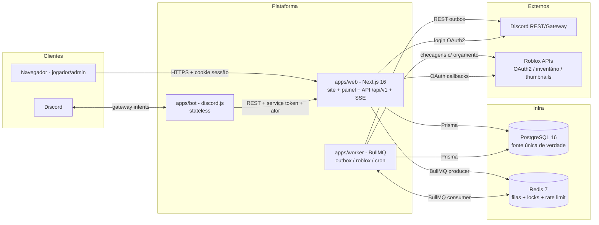
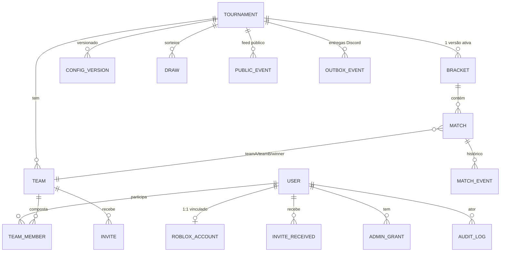
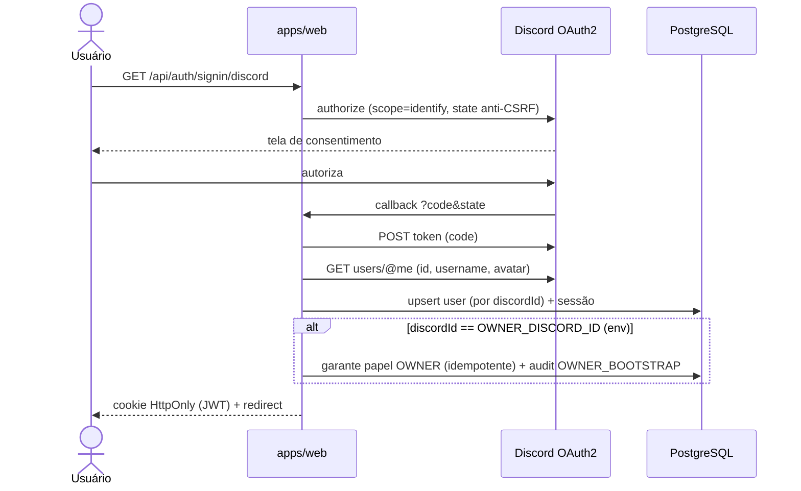
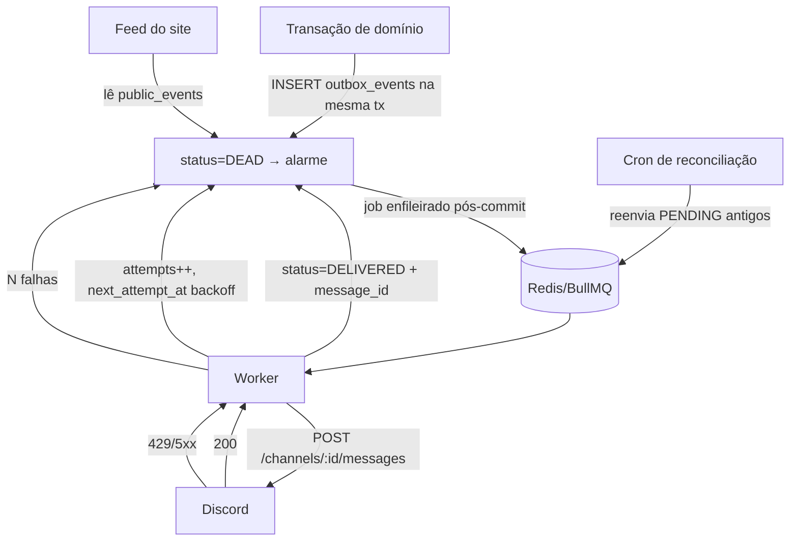

# 06 — Diagramas

## 6.1 Diagrama de componentes



## 6.2 Modelo entidade-relacionamento (simplificado)



## 6.3 Sequência — login Discord + bootstrap do proprietário



## 6.4 Sequência — vínculo Roblox e verificação de acesso

```mermaid
sequenceDiagram
    actor U as Jogador
    participant W as apps/web
    participant R as Roblox
    participant Q as Fila (BullMQ)
    participant WK as Worker

    U->>W: GET /api/v1/roblox/link/start (302)
    W-->>U: redirect apis.roblox.com/oauth/v1/authorize (openid profile, state assinado 10 min)
    U->>R: consentimento
    R->>W: callback ?code&state
    W->>R: POST /oauth/v1/token → userinfo
    W->>W: upsert roblox_accounts (robloxId único; conflito → 409)
    W->>Q: enfileira game-access-check (dedup por robloxId)
    WK->>R: GET inventory .../is-owned (+ can-view-inventory se 403)
    alt 200 possui
        WK->>W: state=HAS_ACCESS
    else 403 "don't own"
        WK->>W: state=NO_ACCESS
    else 403 privacidade / 429 / timeout
        WK->>W: state=INCONCLUSIVE + nextAttemptAt (backoff)
    end
    U->>W: GET /api/v1/roblox/status (estado + botão "tentar novamente")
```

## 6.5 Sequência — início e finalização de partida (com concorrência)

```mermaid
sequenceDiagram
    actor A as Admin
    participant C as Cliente (site/bot)
    participant API as /api/v1
    participant PG as PostgreSQL (transação)
    participant O as Outbox→Worker→Discord

    A->>C: /admin start (autocomplete de confrontos pendentes)
    C->>API: POST /admin/matches/:id/start
    API->>PG: BEGIN; UPDATE matches SET status='IN_PROGRESS', started_at=now() WHERE id=? AND status='PENDING'
    alt rowCount = 1
        PG->>PG: match_events(iniciar) + audit + outbox(match.started); COMMIT
        API-->>C: 200 {match}
        O->>O: publica log público (retry com backoff)
    else rowCount = 0
        PG-->>API: ROLLBACK
        API-->>C: 409 CONFLICT_STATUS (alguém iniciou/estado mudou)
    end

    A->>C: /admin finalizar (select entre teamA/teamB)
    C->>API: POST /admin/matches/:id/finish {winnerTeamId}
    API->>PG: valida winner ∈ {A,B}; UPDATE ... WHERE status='IN_PROGRESS'
    PG->>PG: avança chaveamento + match_events + audit + outbox(match.finished); COMMIT
    API-->>C: 200 {match, nextMatch}
    O->>O: log "Equipe X venceu em 14m32s"
```

## 6.6 Fluxo do outbox (requisito de sincronização)


